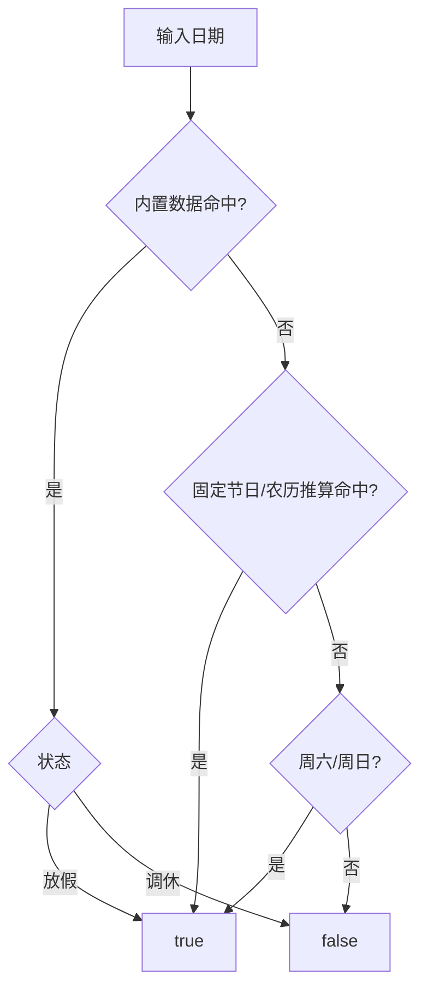

# NewLife.Holiday 架构设计

> 版本：v1.0 | 日期：2026-10-16
> 需求对应：[需求文档](需求文档.md) | 功能清单：[功能清单](功能清单.md)

## 1. 整体架构

单程序集类库，无外部服务依赖；数据内置、逻辑纯计算：

```
调用方（业务代码）
    │  IsChinaHoliday / IsGuangxiHoliday（DateTime 扩展方法）
    ▼
HolidayExtensions（静态入口，周末兜底）          ← NewLife.Holiday
    │
    ▼
IHoliday / ChinaHoliday / GuangxiHoliday        ← 判定核心：数据匹配 + 规则推算
    │            │
    │            ├─▶ Lunar（农历转换/干支/文本）
    │            └─▶ SolarTerms（24 节气计算，供 GetNearestSolarTerm 使用）
    ▼
嵌入式 CSV 资源（China/*.csv、Guangxi/*.csv）    ← 数据层
```

- 唯一依赖 `NewLife.Core`（`CsvFile` 解析、`ToDateTime`/`ToInt` 等扩展方法）
- 目标框架：net45;net461;netstandard2.0;netstandard2.1（覆盖 net45 至 net10 全生态）
- 无反射、无动态代码，NativeAOT 兼容（见 §5.2）

### 判定优先级（不变量）

1. **内置数据命中**（含多天区间与调休）→ 按数据状态返回（放假 `true` / 调休 `false`）。
2. **数据未命中** → 固定节日/农历推算（仅推算放假，不推算调休）。
3. **仍未命中** → 周末兜底（周六/周日 `true`）。

## 2. 核心组件

| 组件 | 所在工程 | 说明 |
|------|----------|------|
| HolidayExtensions | NewLife.Holiday | 静态入口 `China`/`Guangxi`（可替换 `IHoliday`）；`IsChinaHoliday`/`IsGuangxiHoliday` 扩展方法兼周末兜底 |
| IHoliday | NewLife.Holiday | 假期接口：`Query(DateTime)` 返回该日全部假期信息 |
| ChinaHoliday | NewLife.Holiday | 嵌入式资源加载、有序存储、`Query` 匹配 + 7 个固定节日推算方法（TryGetXxx） |
| GuangxiHoliday | NewLife.Holiday | 继承 ChinaHoliday，叠加广西三月三（数据 + 农历预测） |
| HolidayInfo / HolidayStatus | NewLife.Holiday | 假期信息模型（名称/分类/日期/天数/状态）；状态：常规(0)/放假(1)/调休(2) |
| Lunar | NewLife.Holiday | 公历转农历（闰月插位规格化）、干支/生肖/中文月日文本；`GetNearestSolarTerm` |
| SolarTerm / SolarTerms / SolarTermResult | NewLife.Holiday | 节气枚举（小寒..冬至）、日期与时刻计算、最近节气结果（含 `DaysTo`/`IsTermDay`/`IsWithinOneDay`） |
| AotSmoke | AotSmoke | NativeAOT 兼容冒烟程序（16 场景，失败退出码非 0） |
| Test | Test | 控制台示例程序（逐日输出农历/节气） |

## 3. 关键流程

### 3.1 假期判定（IsChinaHoliday）



广西判定在数据/推算层叠加广西三月三（查询结果中优先取 `Category == "Guangxi"` 的条目）。

### 3.2 数据加载与匹配

- 构造时扫描程序集嵌入式资源，加载 `*.China.*.csv` / `*.Guangxi.*.csv`（列：`Name,Date,Days,Status`；Status：1 放假、2 调休）
- 列表按“日期升序、状态升序”排序；`Query` 顺序遍历，遇 `Date > 查询日` 提前退出（数据不足百行，性能可忽略）
- 多天假期以起点 + `Days` 展开匹配（`0 <= (查询日 - 起点) < Days`）
- 无效行（年份 < 1000）跳过；`Days <= 0` 补为 1

### 3.3 节气计算（SolarTerms.GetTermTime）

1. 简化近似公式得到节气日：`floor(Y*D + C) - floor((Y-1)/4)`（`D = 0.2422`，20/21 世纪常数表 + 特殊年份偏移修正）
2. 以近似日为中心 ±2 天（找不到符号变化时放宽 ±7 天）按 6 小时步长扫描太阳视黄经与目标黄经的符号变化
3. 二分逼近至 0.5 分钟容差，转本地时区并舍入到分钟

## 4. 设计决策

| 决策 | 选项 | 选择 | 理由 |
|------|------|------|------|
| 数据载体 | 嵌入式 CSV / 硬编码 / 在线接口 | 嵌入式 CSV | 每年人工维护直观易校；离线可用；零外部依赖；随包分发 |
| 无数据年份策略 | 拒绝返回 / 规则推算 / 沿用上一年 | 规则推算（仅放假） | 固定节日规则稳定，农历节日可由 BCL 日历推算；**不推算调休**，避免错误上班日判定 |
| 农历数据来源 | ChineseLunisolarCalendar / 自研历表 | BCL 日历 + 闰月插位规格化 | 免维护历表；将闰月插位规格化为 1-12 并单独标识 `IsLeapMonth`，规避月份错位 |
| 节气算法 | 简易近似公式 / 高精度天文历（VSOP87） | 简化黄经模型 + 二分 | 体积小、够用：时刻误差 ±15 分钟内（日期级判断无影响）；`GetAllTimes` 供分钟级消费 |
| 时区策略 | 固定北京时间 / 跟随本地时区 | 跟随本地时区 | 库遵循 .NET 本地时区语义；CI 固定中国时区保证日期断言确定性；测试时刻断言采用 UTC 绝对时刻 |
| 结果缓存 | 每次判定重建 / 静态单例 | 静态单例（`HolidayExtensions.China/Guangxi`）+ 属性可替换 | 数据不足百行，构造毫秒级；`IHoliday` 接口允许替换自定义实现 |
| 目标框架 | 仅现代 TFM / 全生态 TFM | net45~netstandard2.1 | 与 NewLife 生态约定一致；高版本消费走 netstandard2.1，NativeAOT 冒烟覆盖运行时形态 |

## 5. 工程与质量保障

### 5.1 覆盖矩阵（.github/workflows，push/PR + 手动触发，无夜间任务）

| RID | test.yml | aot.yml |
|-----|----------|---------|
| win-x64 | windows-latest 原生全量单测 | windows-latest 原生 NativeAOT 发布运行 |
| linux-x64 | ubuntu-latest 原生全量单测 | ubuntu-latest 原生 NativeAOT 发布运行 |
| linux-arm64 | ubuntu-24.04-arm 原生全量单测 | ubuntu-24.04-arm 原生 NativeAOT 发布运行 |
| linux-loongarch64 | QEMU + 龙芯 SDK 全量单测（阻断门禁） | QEMU 运行时冒烟（必选阻断）+ NativeAOT 发布（探索，continue-on-error） |

### 5.2 AOT 兼容

- 库无反射/动态代码；嵌入式资源经 `GetManifestResourceNames`/`GetManifestResourceStream` 读取，NativeAOT 原生发布后资源可用
- `AotSmoke` 16 场景覆盖数据加载、判定、推算、农历、节气；同一程序以运行时形态与 NativeAOT 形态各跑一遍对照
- 本机验证：win-x64 NativeAOT 发布运行 16/16 通过（`IsDynamicCodeSupported=False`）
- CI 实跑（2026-10-16）：win-x64/linux-x64/linux-arm64 原生 NativeAOT 全绿；LA64 在 QEMU 容器内以运行时形态冒烟 16/16 通过（必选门禁）；LA64 的 NativeAOT 原生发布为探索步骤，当前受阻于 QEMU 下龙芯 SDK 的 NuGet 还原 NRE（MSB4018），且跨 OS 原生编译不被官方支持，官方支持到位后可转正

### 5.3 时区与确定性

- Windows runner 经 `tzutil` 固定中国时区；Linux/容器经 `TZ=Asia/Shanghai`（容器内补装 `tzdata`）
- 测试对“跨时区稳定”的节气日期直接断言；对全部发布时刻断言 UTC 绝对时刻（±45 分钟窗口）
- QEMU 下关闭硬件内建（`DOTNET_EnableHWIntrinsic=0`）规避 LASX/LSX 指令覆盖不全导致的非法指令崩溃

### 5.4 本地验证命令

```bash
dotnet build -c Release                      # 全解决方案（含 net45/net461）
dotnet test XUnitTest/XUnitTest.csproj -c Release
dotnet run -c Release --project AotSmoke/AotSmoke.csproj
dotnet publish AotSmoke/AotSmoke.csproj -c Release -r win-x64 -o AotSmoke/bin/aot-out
./AotSmoke/bin/aot-out/AotSmoke.exe
```
